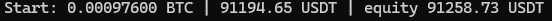
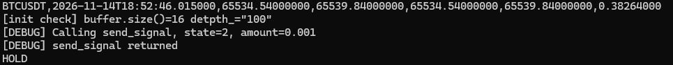
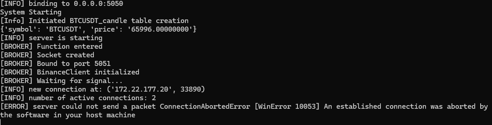

# Bitcoin_bot

A Bitcoin trading bot with a high-performance **C++23** engine for market data and signal generation, and a **Python 3.12** application layer. <!-- TODO: add one sentence on what the Python side does (dashboard, backtesting, analysis, etc.) -->


> **Disclaimer:** This project is for educational and research purposes. Trading cryptocurrency carries real financial risk. Test with paper trading before using real funds. You are responsible for any losses.

---

## Screenshots

<!-- Replace the paths below with your own images in the docs/ folder -->

| Dashboard | Live signals |
| --- | --- |
|  |  |

| Backtest results | Architecture |
| --- | --- |
|  |  |

---

## Features

- Real-time price ingestion into a ring/price buffer (`PriceBuffer`)
- SQLite persistence for candles and trades (`DbHandler`)
- Strategy engine with pluggable signal generation
- Paper trading strategy testing (for now)
- Simple python CLI monitoring app
- <!-- TODO: Python features (backtesting, plotting, monitoring) -->

---

## Project Structure

```
Bitcoin_bot/
├── cpp_engine/     # C++23 engine: data handling, strategy, persistence
├── python_app/     # Python 3.12 application layer
├── docs/           # Documentation and images
├── LICENSE         # Apache-2.0
└── README.md
```

---

## Requirements

| Component | Version |
| --- | --- |
| C++ compiler | GCC 13+ or Clang 17+ with C++23 support |
| CMake | 3.20+ |
| SQLite3 | dev libraries (`libsqlite3-dev`) |
| Python | 3.12 |
| pip | latest |

<!-- TODO: add any other dependencies (exchange API, TWS API, etc.) -->

---

## Setup

### 1. Clone the repository

```bash
git clone https://github.com/TWAZZY98/Bitcoin_bot.git
cd Bitcoin_bot
```

### 2. Build the C++ engine

Install dependencies (Ubuntu / WSL):

```bash
sudo apt update
sudo apt install build-essential cmake libsqlite3-dev
```

Build with CMake:

```bash
cd cpp_engine
cmake -S . -B build
cmake --build build
```

Or compile quickly with g++:

```bash
g++ main.cpp client.cpp dbhandler.cpp pricebuffer.cpp signalgen.cpp -std=c++23 -pthread -lsqlite3 -o btc_engine
```

### 3. Set up the Python app

```bash
cd python_app
python3.12 -m venv venv
source venv/bin/activate        # Windows: venv\Scripts\activate
pip install -r requirements.txt
```

### 4. Configuration

Create a `.env` or config file inside python_app folder with your settings:

```env
# TODO: replace with your real settings
BINANCE_BASE_URL="https://api.binance.com"
BINANCE_API_KEY= <live trading api linked to your actual account>
BINANCE_API_SECRET=
BINANCE_API_KEY_P= <paper trading api given by binance test api>
BINANCE_API_KEY_SECRET_P=
```

> Never commit API keys. Make sure `.env` is listed in `.gitignore`.

---

## Usage

Start the C++ engine:

```bash
./cpp_engine/build/bitcoin_bot
```

Start the Python app:

```bash
python python_app/main.py   # TODO: confirm entry point
```

---

## How It Works

<!-- Add an architecture diagram in docs/images/architecture.png -->

1. The engine receives price data and stores it in the `PriceBuffer`.
2. Candles are persisted to SQLite through the `DbHandler`.
3. The strategy reads the buffer and generates buy, sell or hold signals.
4. The Python app <!-- TODO: describe what it does with the signals -->.

---

## Roadmap

- [ ] Paper trading mode
- [ ] Live order execution
- [ ] More strategies and indicators
- [ ] Backtesting reports
- [ ] Unit tests and CI

---

## Contributing

Pull requests are welcome. For major changes, please open an issue first to discuss what you would like to change.

---

## License

Distributed under the Apache-2.0 License. See [LICENSE](LICENSE) for details.